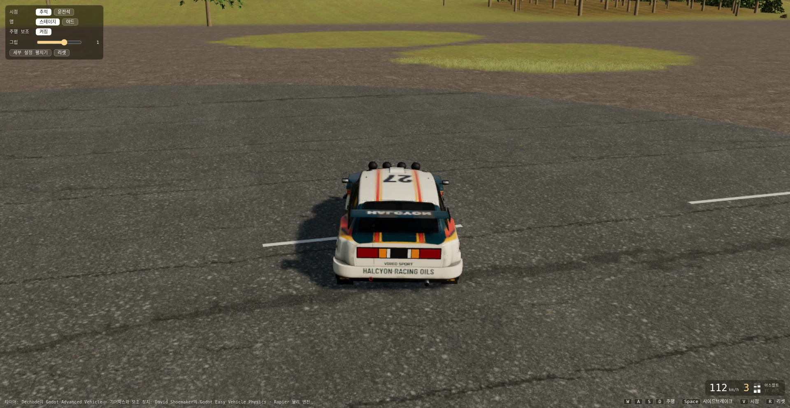
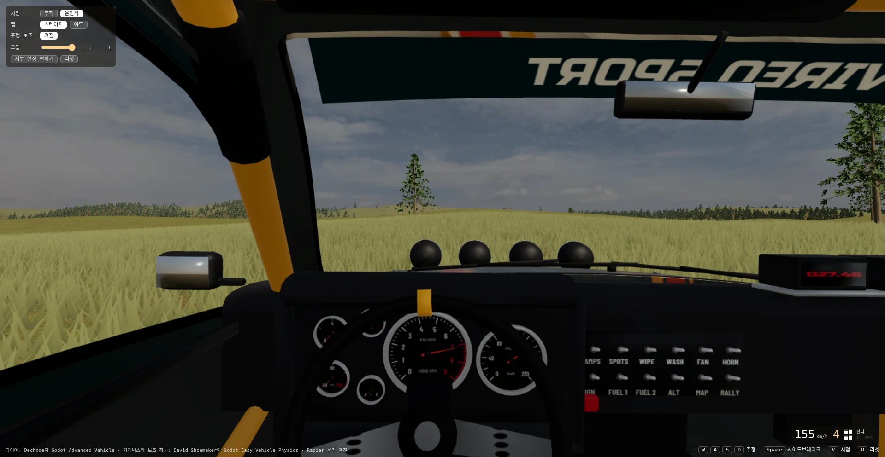
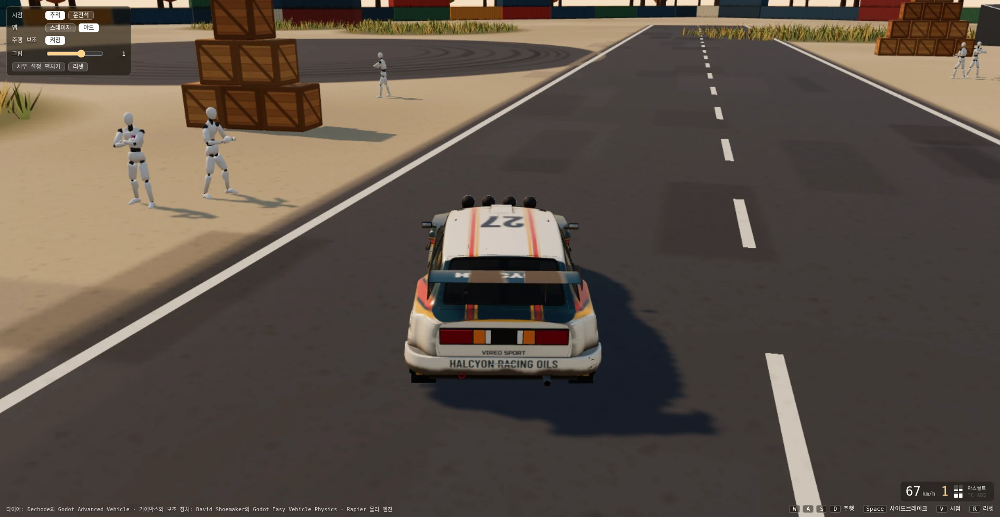

# 리얼리스틱 카 한글판 (Realistic Car KO)

Patch의 **Realistic car**(@patch, https://patch.gg/patch/car)를 한국어로 옮긴 비공식 한글판입니다. 실제 차 크기와 실제 중력 위에서 Rapier 물리 엔진으로 돌아가는 랠리 카 주행 데모로, 브라우저에서 바로 플레이할 수 있습니다.

**플레이:** https://sigco3111.github.io/realistic-car-ko/
**원작:** https://patch.gg/patch/car · 소스: https://git.patch.gg/patch/car.git



## 소개

타이어가 그립을 쌓고 한계를 넘어 미끄러지고, 서스펜션이 눈앞에서 움직이고, 엔진과 기어박스가 회전수에 맞춰 변속합니다. 사이드브레이크는 뒷바퀴를 잠그고, 노면은 아스팔트·자갈·잔디로 나뉩니다. 숲을 도는 랠리 스테이지와 장애물이 놓인 낡은 야드, 두 맵에서 Patch의 그룹 B 스타일 랠리 카 "Vireo"를 몰 수 있습니다.

## 주요 기능

- 실제 스케일·실제 중력의 차량 물리(Rapier), 120Hz 고정 스텝 시뮬레이션
- 노면별 그립: 아스팔트 / 자갈 / 잔디 (HUD에 현재 노면 표시)
- 추적 시점과 운전석 시점 (V키 전환), 드래그로 시점 회전, 휠로 줌
- 한글 설정 패널: 시점, 맵, 주행 보조(ABS·트랙션 컨트롤·스티어링 보조), 그립, 서스펜션, 슬로우 모션, 출력, 앞바퀴 구동, 조향각, 전복 후 복구 시간, 리셋 — 원작 호스트 페이지의 조작을 그대로 제공
- 마네킹·상자·드럼통과의 충돌, 노면과 차체에 맞는 실제 녹음 효과음

## 실행 화면

| 랠리 스테이지 | 운전석 시점 | 야드 맵 |
| --- | --- | --- |
|  |  |  |

## 조작법

| 키 | 동작 |
| --- | --- |
| W A S D (또는 방향키) | 주행 |
| Space | 사이드브레이크 |
| V | 시점 전환 (추적 ↔ 운전석) |
| R | 리셋 |
| 마우스 드래그 / 휠 | 시점 회전 / 줌 |

## 설치와 실행

```bash
npm install
npm run build   # dist/ 에 정적 파일 생성
npm run dev     # 개발 서버 (127.0.0.1:5393)
```

`dist/`는 정적 파일 묶음이라 그대로 어디든 올리면 됩니다. 이 저장소는 GitHub Actions로 Pages에 자동 배포됩니다.

## 기술 노트

- three.js 0.186.1 + @dimforge/rapier3d-compat 0.17.3
- 타이어 모델은 Dechode의 Godot Advanced Vehicle, 기어박스·서스펜션·보조 장치는 Godot Easy Vehicle Physics(David Shoemaker, Dechode, Baron Wittman)를 이식한 것 (모두 MIT)
- 차량 물리(src/car.js)는 three.js와 무관하게 Rapier만으로 동작
- 한글화 범위: HUD·키 안내·설정 패널·로딩 문구·노면 표시·월드 내 배너(노르드비크 랠리/오를라 타이어)·호스트 컨트롤 라벨. 단독 배포에서 원작 호스트 페이지의 설정 패널이 사라지지 않도록 한글 패널을 게임 안에 재구현함

## 라이선스와 원작 크레딧

- 코드: MIT / 아트·사운드: CC0 / 스테이지의 나무·나뭇잎: MIT (ez-tree). 부분별 출처와 라이선스는 [LICENCE-NOTES.md](LICENCE-NOTES.md)와 [CREDITS.txt](CREDITS.txt) 참고
- 타이어: [Godot Advanced Vehicle](https://github.com/Dechode/Godot-Advanced-Vehicle) (Dechode, MIT)
- 기어박스·서스펜션·보조 장치: [Godot Easy Vehicle Physics](https://github.com/DAShoe1/Godot-Easy-Vehicle-Physics) (David Shoemaker, Dechode, Baron Wittman, MIT)
- 차량 "Vireo"와 마네킹: Patch (CC0), 사운드: Freesound 녹음들 (CC0, [public/audio/CREDITS.txt](public/audio/CREDITS.txt))
- 스테이지 지형·하늘·바위: Poly Haven (CC0), 나무: [ez-tree](https://github.com/dgreenheck/ez-tree) (MIT), 수목 수복: [folio-2025](https://github.com/brunosimon/folio-2025) (Bruno Simon, MIT)

이 저장소는 원작자의 한국어 사용자를 위한 비공식 번역판이며, 원작의 라이선스를 그대로 따릅니다.
